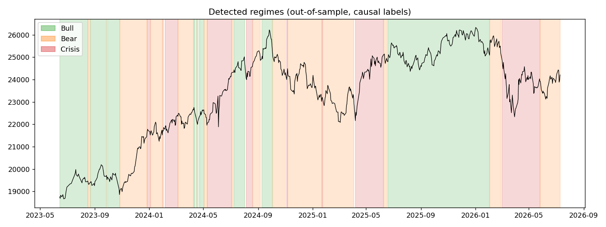
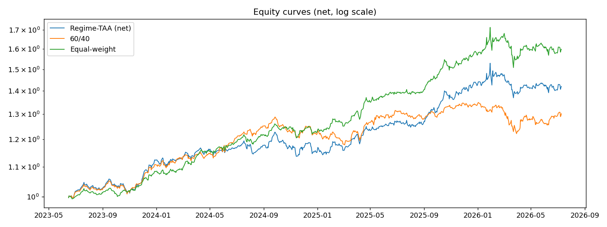
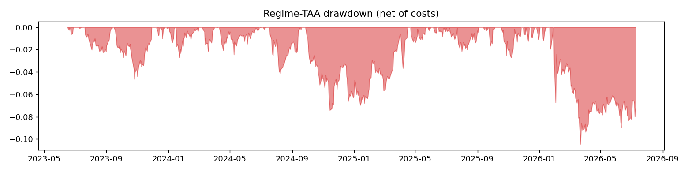

# Regime-Shift Tactical Asset Allocation

An HMM learns Bull, Bear and Crisis regimes in Indian markets, and a convex optimizer reallocates across equities, gold and bonds with a different objective in each regime. Everything is tested with a leak-free walk-forward harness.

Built as my Summer of Quant (SoQ) advanced project.

## What it is

A pipeline that answers one question. If a model can tell which "mood" the market is in each day, using only past data, can it allocate better than a static portfolio?

- **Assets:** a Nifty 50 ETF (`NIFTYBEES.NS`), a gold ETF (`GOLDBEES.NS`) and a long-term gilt ETF (`LTGILTBEES.NS`), pulled from yfinance.
- **Regime signal:** the Nifty 50 index and the India VIX.
- **Model:** a 3-state Gaussian HMM (`hmmlearn`) fitted to backward-looking features. Its states are unlabeled, so no regime is labeled by hand.
- **Allocation:** `cvxpy` solves long-only, fully invested weights with a 70% cap per asset. Each regime uses its own objective.
- **Evaluation:** an expanding walk-forward with refits in every fold, 10 bps of cost on turnover, and two benchmarks: 60/40 and equal-weight.

## What I did

```
prices + India VIX ──> features (1d log-return, 63d momentum, 21d realized vol,
                       VIX vs its 1y average; all backward-looking)
      ──> expanding walk-forward: scaler + HMM fit on TRAIN only (5 seeds, best LL)
          states relabeled Bull/Bear/Crisis by ascending vol mean
          TEST days labeled causally (Viterbi on data <= t, one day at a time)
      ──> per-regime mu, Sigma from TRAIN days ──> cvxpy weights
          Bull: max mu'w - 2 w'Sigma w | Bear: max mu'w - 10 w'Sigma w | Crisis: min w'Sigma w
      ──> backtest: weights.shift(1), 10 bps costs, 2-day regime-confirmation debounce
```


*Out-of-sample Bull/Bear/Crisis labels (causal Viterbi) shaded over the Nifty 50.*

Key decisions:
- **3 states and diagonal covariance.** Each extra state adds a whole (mu, Sigma) block to estimate from limited daily data. A full covariance would triple the parameters for each state. Fitting from 5 EM seeds makes up for the rougher fit.
- **Relabeling states by volatility in every fold.** The index of an HMM state is arbitrary from one fit to the next. Sorting the states by the mean of the volatility feature gives them stable names, which also solves the problem of matching states across folds.
- **Causal labeling.** `model.predict(window)` is smoothed, so it quietly uses later days to label earlier ones. Instead, I run Viterbi on data up to day *t* only.
- **Debounce.** I adopt a regime switch only after 2 consecutive days of the new label, which cuts the cost of whipsaws. I report both gross and net returns so the cost drag stays visible.

**Results** (real NSE data, from `results/RESULTS.md`). The out-of-sample window runs from 2023-06-14 to 2026-07-10 over 12 expanding folds, with annualized turnover of 8.26x:

| | AnnRet | AnnVol | Sharpe | MaxDD |
|---|---|---|---|---|
| Regime-TAA (net) | 12.5% | 9.3% | 1.35 | -10.4% |
| 60/40 static | 9.4% | 7.7% | 1.22 | -9.5% |
| Equal-weight | 16.5% | 9.1% | 1.82 | -12.0% |


*Net equity curves (log scale) for Regime-TAA vs the 60/40 and equal-weight benchmarks.*


*Drawdowns over the out-of-sample window.*

So the strategy beat 60/40 on return and Sharpe. **It did not beat a plain equal-weight portfolio**, which had a higher Sharpe, Sortino and Calmar over this window. I have kept that result in rather than tuning until it went away.

## What I learnt

- **A simple benchmark is hard to beat.** Equal-weight across equity, gold and bonds won on Sharpe over this window. The regime-conditional means behind my optimizer are noisy sample estimates, so a lot of the "intelligence" can turn out to be estimation error. That made me much more sceptical of "smart" allocation in general.
- **Look-ahead hides in convenient APIs.** I didn't expect `predict()` on an HMM to leak, but smoothing (forward-backward) uses the whole window. Switching to step-by-step Viterbi changed how I think about any "label this series" function.
- **HMM states have no fixed meaning.** Without a canonical relabeling, "state 0" can mean Bull in one fold and Crisis in the next. Every downstream statistic would then be silently wrong.
- **Data availability shapes the experiment.** I asked for data from 2010, but the inner join with the Indian ETF and VIX histories started the usable sample in 2018-05. With a 5-year training burn-in, the 2022 stress period ended up training-only. Only a handful of genuine Crisis episodes exist out of sample, so the per-regime statistics should be read cautiously.
- **Test the leakage, don't just assume it away.** `tests/test_pipeline.py` changes every price after date *t* and asserts that every feature row before *t* is bit-identical. A synthetic 3-regime simulator also lets me check that the HMM can actually recover regimes it knows are there.
- **Costs and turnover matter.** Even with the debounce, turnover is 8.26x a year, and costs take Sharpe from 1.44 (gross) to 1.35 (net). A rebalancing band that accounts for costs is the obvious next step.
- **Known simplifications.** Weights are held at their targets between rebalances (no drift), for both the strategy and the benchmarks.

## Repo structure

```
src/data.py         yfinance pulls, validation, alignment (fails loudly on short series)
src/features.py     backward-looking features (VOL_COL drives state labeling)
src/hmm_model.py    multi-seed fit, canonical relabeling, causal prediction
src/walkforward.py  expanding folds, train-only scaling and fitting, per-regime stats
src/portfolio.py    cvxpy per-regime weights, debounce, backtest, metrics
src/synthetic.py    3-regime simulator for offline validation and tests
run_pipeline.py     end-to-end runner, writes results/
results/            RESULTS.md plus regime, equity and drawdown charts
tests/              leak guards, optimizer sanity, end-to-end and regime recovery
notebooks/          thin notebook that drives the same modules
```

## How to run

```bash
python -m venv .venv && source .venv/bin/activate
pip install -r requirements.txt
pytest -q                            # leak guards + end-to-end synthetic test
python run_pipeline.py --synthetic   # offline validation, no network needed
python run_pipeline.py               # real NSE data via yfinance
python run_pipeline.py --cost-bps 20 # change the transaction-cost assumption
```

The outputs go to `results/`: `RESULTS.md`, `regimes.png`, `equity_curves.png` and `drawdown.png`. Yahoo symbols sometimes die. If a download fails, swap the tickers in `src/data.py`.
